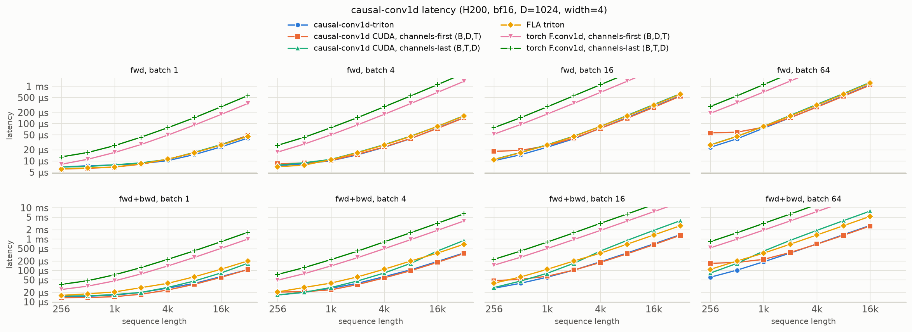
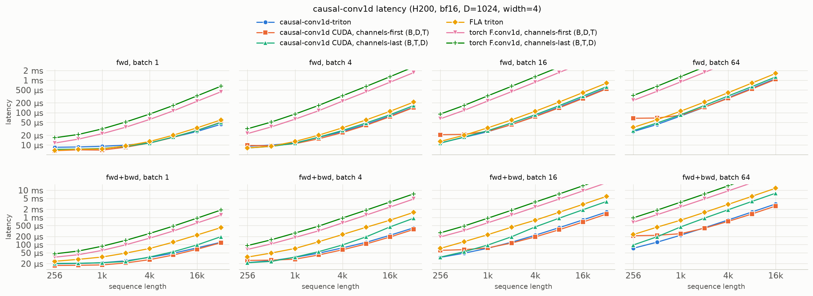

# causal-conv1d-triton

A Triton port of [causal-conv1d](https://github.com/Dao-AILab/causal-conv1d) with channels-last
inputs.

```python
out[b, t, d] = act(bias[d] + sum_k weight[d, k] * x[b, t - (W - 1) + k, d])
```

## Install

```sh
pip install .
```

Requires a CUDA GPU, PyTorch, and Triton.

## Usage

```python
import torch
from causal_conv1d_triton import causal_conv1d_fn

x = torch.randn(2, 1024, 512, device="cuda", dtype=torch.bfloat16, requires_grad=True)
weight = torch.randn(512, 4, device="cuda", requires_grad=True)  # (dim, width)
bias = torch.randn(512, device="cuda", requires_grad=True)

out = causal_conv1d_fn(x, weight, bias, activation="silu")  # (2, 1024, 512)
out.sum().backward()

# Chunked / streaming: state = the last width - 1 inputs
out1, state = causal_conv1d_fn(x[:, :512], weight, bias, return_final_states=True)
out2 = causal_conv1d_fn(x[:, 512:], weight, bias, initial_states=state)
```

## Differences from causal-conv1d

- `x` should have shape `(batch, seqlen, dim)` and be contiguous along `dim`
- Initial and final states should be `(batch, width - 1, dim)`
- Supports arbitrary `width >= 2`

## Notes

- `seq_idx` `(batch, seqlen)` packs several sequences into one row. Taps only read inputs from the
  same sequence, negative ids are padding (output 0), and `initial_states` count as part of
  `seq_idx[:, 0]`'s sequence. Can't be combined with `return_final_states`
- Launch heuristics were tuned on an H200

## Benchmarks

H200, bf16, `dim=1024`, `width=4`.

No bias, no activation:



With bias and silu activations:


